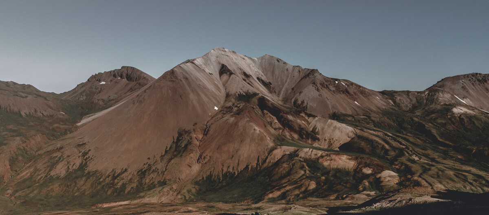

<!-- grav: {"file":"02.sample-guide/section-list.md","images":["mountain.jpg"]}
title: 'Sample Guide'
subtitle: 'A second guide, for trying out the Guides List page'
cover_image: mountain.jpg
cover_image_alt: 'Bare, reddish-brown mountains under a clear sky'
authors: 'Your Name'
edition: 'Draft, 2026'
badge_label: Draft
section_label: Section
cards_per_row: 3
published: true
child_type: section
-->

<!-- grav:gen -->

# Sample Guide

A second guide, for trying out the Guides List page

Your Name

<small>Draft, 2026</small>

[Start Reading](sample-guide/section-one/README.md ":class=button :class=primary")

<!-- /grav:gen -->

A sample guide, with placeholder sections and pages copied from the Multi-Section Page example. Together with the **Guides** page (a Guides List page), it shows how a site with more than one guide looks.

To remove this guide, unpublish it or delete its folder (`02.sample-guide`).

<!-- grav:gen -->

Section 1

<h2><a href="#/sample-guide/section-one/README">Section One</a></h2>

Section 2

<h2><a href="#/sample-guide/section-two/README">Section Two</a></h2>

Section 3

<h2><a href="#/sample-guide/section-three/README">Section Three</a></h2>

<!-- /grav:gen -->

<!-- grav:gen -->
<!-- Hides the sidebar on this page -->

<!-- /grav:gen -->
